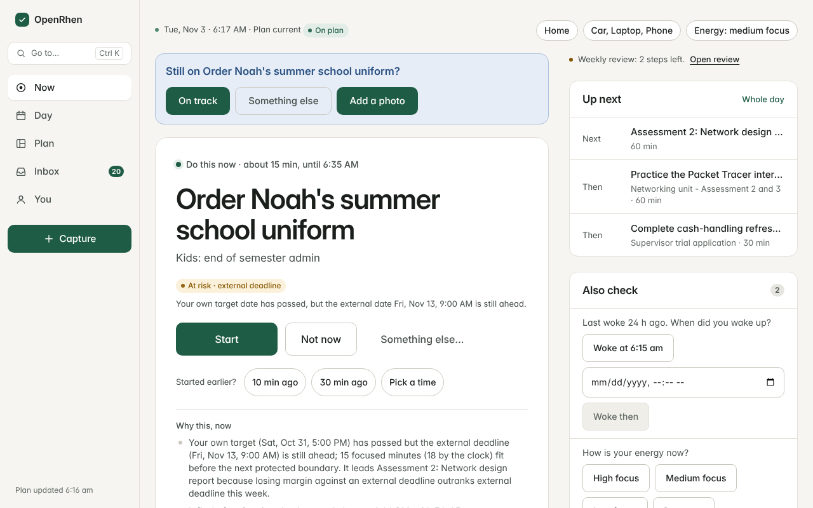
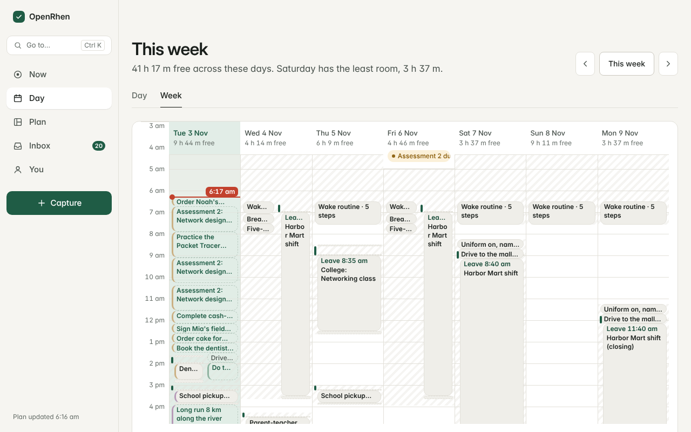
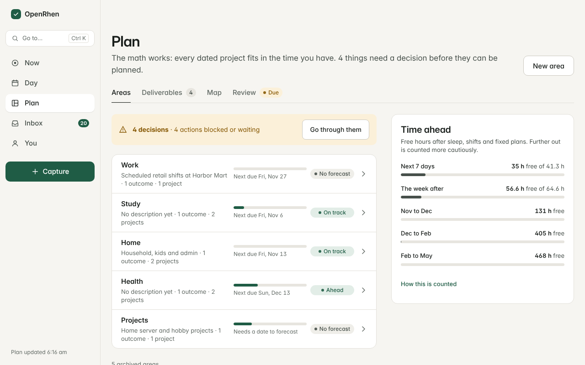
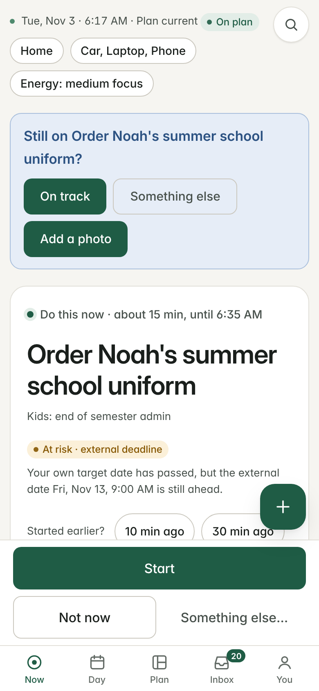

# OpenRhen

OpenRhen is a self-hosted planner that works out **what you should do right now, for how long, and why**. You describe your areas, projects, actions, deadlines, commitments, energy and the places and equipment work needs; a deterministic engine turns that into one recommendation, a forecast of whether each project fits, and a plan for the day. The same inputs and the same clock always produce the same answer, and every recommendation comes with its reasoning.

## What this is

OpenRhen is a self-hostable planner engine, portal and agent server for one person. You enter things by hand in the portal, or through an AI agent using the command line or MCP. There are no roster connectors; calendar input comes from Google Calendar or any iCal feed. No images are published yet, so the first build compiles from source. Backups run nightly on their own and stay on this machine until you set `BACKUP_COPY_DIR` (see [Self-hosting](docs/operations/self-hosting.md#backups)).

> **Status: pre-1.0.** OpenRhen is usable but young. Screens, commands and schemas can change between minor versions; the [changelog](CHANGELOG.md) says when. It is built for one person per installation.

**No telemetry.** OpenRhen does not phone home, collect analytics or report usage. The only outbound calls are the ones you opt into: [connections](docs/architecture/writing-a-connection.md) go through one proxy that holds the credentials, and the optional agent wake (`OPENCLAW_HOOKS_URL`) and backup ping (`BACKUP_PING_URL`) are set in `.env`. Building the images also downloads packages.

## What it looks like

These screenshots are the bundled demo data, not a real person's plan.



<table>
  <tr>
    <td width="50%"></td>
    <td width="50%"></td>
  </tr>
</table>



## Quick start (Docker)

You need git and Docker with Compose v2, with 8 GB of memory available to Docker and 20 GB of free disk for the first build. No Node or pnpm. These commands work in any common shell, on Linux, macOS and Windows:

```text
git clone https://github.com/Jondi-Studio-Public/openrhen.git && cd openrhen
docker compose run --rm setup
docker compose up -d
```

Open `http://localhost:8787`. `setup` writes `.env` with generated secrets, and the stack includes its own PostgreSQL, reachable from this machine only. The first `up` builds the images from source on your machine (linux/amd64 and linux/arm64), which takes a few minutes. No published images exist yet, so until the first release every install builds from your checkout; once images are published, `docker compose pull` fetches them and `up` uses them instead of rebuilding (set `IMAGE_TAG` to a version to pin one). Backups run nightly on their own and stay in `var/backups` on this machine until you point `BACKUP_COPY_DIR` somewhere else (`BACKUP_COPY=off` accepts local-only on purpose); the Data check reminds you they do not leave the machine. See [Self-hosting](docs/operations/self-hosting.md#backups).

To reach OpenRhen from other devices, lock it down first. [Self-hosting](docs/operations/self-hosting.md) covers that, upgrades, backups, running from source and troubleshooting.

## What is in the box

- **Now**: the one thing to do, why it was chosen, and what else fits; sessions with feedback; check-ins.
- **Day and Week**: a to-scale plan of the day with commitments, travel, preparation, routines and sleep.
- **Plan**: areas, outcomes, projects, actions and deliverables, with forecast cards showing whether the maths works.
- **Inbox and Import**: capture, paste or photo, workbook and CSV, and calendar events, all reviewed before they change anything.
- **Review**: a weekly review that proposes the smallest fixes for projects that are behind.
- **`rhen`**: a command line and MCP server so scripts and AI tools can work the same data through the same validated commands.

## Architecture in brief

A web portal, a stateless planning service, a durable job worker and an outbound proxy, around one PostgreSQL database. The planning engine is a pure library. Third-party credentials never reach the portal. See the [architecture overview](docs/architecture/overview.md).

## Documentation

Start at the [documentation index](docs/README.md). The most useful pages:

- [User guide](docs/product/user-guide.md)
- [Engine logic](docs/engine/logic.md)
- [Self-hosting](docs/operations/self-hosting.md)
- [Writing a connection](docs/architecture/writing-a-connection.md)

## Contributing

Contributions are welcome under the Developer Certificate of Origin; there is no CLA. Read [CONTRIBUTING.md](CONTRIBUTING.md), the [Code of Conduct](CODE_OF_CONDUCT.md) and [GOVERNANCE.md](GOVERNANCE.md). Report vulnerabilities privately as described in [SECURITY.md](SECURITY.md).

## Licence

Apache License 2.0. See [LICENSE](LICENSE) and [NOTICE](NOTICE). The bundled Inter font is under the SIL Open Font License 1.1. Licence texts are in [LICENSES/](LICENSES/).
